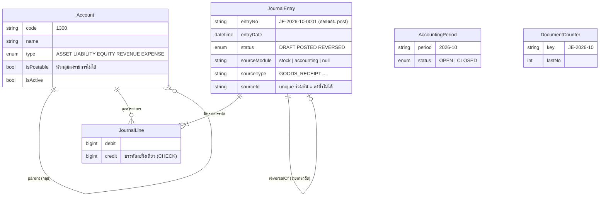

# คู่มือระบบ Accounting / General Ledger

โมดูลบัญชีแยกประเภท (double-entry) ที่เสียบเข้ากับ ERPHUB เหมือน Stock & Purchase และ **รับข้อมูลจาก Stock อัตโนมัติ** (รับของเข้าคลัง → ลงบัญชีให้เอง) เอกสารนี้อธิบาย **มีอะไรบ้าง ทำไมออกแบบแบบนี้ และใช้งานอย่างไร** — แผนออกแบบเต็มอยู่ที่ `plan/ACCOUNTING_PLAN.md`

โค้ด: `K-ERP/Accounting/Accounting-Backend` (Express + Prisma + PostgreSQL, พอร์ต 4002) และ `Accounting-Frontend` (React + Vite)

---

## 1. ภาพรวม

```
ผู้ใช้ ──login──▶ K-ERPHub ──proxy /erp/accounting/*──▶ Accounting (verify JWT เดียวกัน)
                                                            ▲
Stock ── รับของ/ปรับสต็อก ──▶ outbox_messages ──worker──▶ POST /api/postings (X-Service-Key)
```

- **ไม่มี login ของตัวเอง** — ตรวจ JWT ที่ Hub เซ็น (`JWT_SECRET` เดียวกัน) และต้องมี `"accounting"` ใน `allowedModules` ทั้งที่ Hub และที่ backend
- **สิทธิ์**: ดูรายงาน = ทุกคนที่มีสิทธิ์โมดูล · ลงรายการ/post/reverse = `Accountant` หรือ `Admin` · ปิดงวด/ปิดปี = `Admin`
- **เงิน** = จำนวนเต็มสตางค์ (`BigInt`) ส่งให้หน้าเว็บเป็น string ไม่ผ่าน float/Number เลย

## 2. ER diagram



`AccountingPeriod` และ `DocumentCounter` ไม่ผูก FK กับตารางอื่น: งวดคำนวณจาก `entryDate` ตามเวลา Asia/Bangkok ส่วน counter ถูก lock ตอน post เพื่อให้เลขที่เอกสารรันต่อเนื่องไม่ข้าม

## 3. กฎที่ระบบบังคับ (และบังคับที่ไหน)

| กฎ | บังคับที่ |
|---|---|
| ΣDr = ΣCr, อย่างน้อย 2 บรรทัด, บรรทัดละฝั่งเดียว | `journal.validator.ts` (pure, test หนักสุด) + CHECK constraint ใน DB |
| บัญชีต้อง `isPostable && isActive` | service ตอนบันทึกร่างและตอน post |
| **Posted = แก้ไม่ได้** แก้ผิดด้วย reverse | allow-list สถานะ + **DB trigger** (ใช้ SQL ตรงก็แก้ไม่ได้) |
| งวดปิดแล้วห้ามลง | `assertPeriodOpen` → 409 (รายการจากคน) |
| event จาก Stock ต้องลงได้เสมอ | งวดปิด → เลื่อนไปงวดเปิดถัดไป + memo วันที่จริง |
| ลงซ้ำไม่ได้ | `unique(sourceModule, sourceType, sourceId)` — ส่ง event ซ้ำได้ผลเดิม |
| เลขที่เอกสารไม่ข้าม | counter row-lock ตอน post ใน transaction เดียวกัน |
| ปีที่ปิดแล้ว/มีร่างค้าง/ปีก่อนยังไม่ปิด | year-end preview แจ้ง blocker, close → 409 |

## 4. รายงานและ Excel

| รายงาน | หมายเหตุ |
|---|---|
| Trial Balance | Dr รวม = Cr รวม ทุกครั้ง — ถ้าไม่เท่าหน้าจอแจ้งเตือนแดง |
| General Ledger | ยอดยกมา + รายการ + ยอดสะสมทีละบรรทัด |
| Income Statement (งบกำไรขาดทุน) | รายได้ − ค่าใช้จ่าย **ไม่นับ** closing entry ปีที่ปิดแล้วจึงยังเห็นผลจริงของปีนั้น |
| Balance Sheet (งบดุล) | สินทรัพย์ = หนี้สิน + ส่วนเจ้าของ + "กำไรสุทธิสะสมที่ยังไม่ปิด" จึง balance ได้ทุกวันที่ ไม่ใช่แค่หลังปิดปี |

รายงานนับสถานะ `POSTED` **และ `REVERSED`** (ต้นฉบับที่ถูกกลับต้องอยู่เพื่อหักล้างกับรายการกลับ) ตัดเฉพาะ `DRAFT`
ปุ่ม **Export Excel** ในหน้า Trial Balance / Income Statement / Balance Sheet — ไฟล์เป็นตัวเลขจริง (ไม่ใช่ข้อความ) ใช้สูตรต่อได้

## 5. ปิดปี (Year-end close)

เมนู **Periods → Year-end close** (Admin): เลือกปี → **Preview** ดูรายการปิดบัญชีและ blocker → ยืนยัน

1. สร้างรายการเดียวลงวันที่ 31 ธ.ค.: ปิดบัญชีรายได้/ค่าใช้จ่ายทุกตัวเป็นศูนย์ ผลต่างเข้า `3200 กำไรสะสม` (กำไร = Cr, ขาดทุน = Dr)
2. ล็อกครบ 12 งวดของปีนั้น (ใน transaction เดียวกัน — สำเร็จทั้งหมดหรือไม่ทำเลย)
3. ปิดซ้ำไม่ได้ และต้องปิดปีก่อนหน้าให้เสร็จก่อน

## 6. รับข้อมูลจาก Stock

| เหตุการณ์ใน Stock | ลงบัญชี |
|---|---|
| รับของเข้า PO (`GOODS_RECEIVED`) มูลค่า Σ จำนวน × ราคา PO | Dr 1300 สินค้าคงเหลือ / Cr 2150 สินค้ารับแล้วยังไม่วางบิล (GR/IR) |
| ปรับสต็อกลด (`STOCK_ADJUSTED`) | Dr 5200 ขาดทุนจากการปรับปรุงสต็อก / Cr 1300 |
| ปรับสต็อกเพิ่ม | Dr 1300 / Cr 5200 |
| ยอดยกมาของสต็อกเดิมก่อนเปิด integration | Dr 1300 / Cr 3200 (สคริปต์ cut-over ครั้งเดียว) |

**กลไก**: Stock เขียน event ลง `outbox_messages` **ใน transaction เดียวกับการรับของ** (ไม่มีทางหาย / ไม่มี event ผีถ้า rollback) → worker ส่งไป `POST /api/postings` → Accounting ลงด้วย key ที่ไม่ซ้ำ จึงส่งซ้ำได้ไม่เกิดรายการซ้ำ

| ผลจาก Accounting | worker ทำ |
|---|---|
| 2xx | `SENT` |
| ล่ม / timeout / 5xx | retry แบบ exponential backoff (5 วินาที → สูงสุด 15 นาที, 8 ครั้ง) |
| 4xx (เช่น บัญชีที่ map ถูกปิดใช้งาน) | `FAILED` ทันที ไม่ retry — Admin ดูที่ `GET /api/outbox?status=FAILED` แก้ต้นเหตุ แล้ว `POST /api/outbox/:id/retry` |

ปิด Accounting ไว้ Stock ก็ยังรับของได้ตามปกติ event รอใน outbox แล้วส่งเมื่อ Accounting กลับมา (ทดสอบแล้วใน e2e)

## 7. วิธีรัน

```bash
docker start k-erp-stock-pg                     # Postgres :5433 (ฐานข้อมูลแยก k_erp_accounting)

# Accounting
cd "Accounting/Accounting-Backend"
cp .env.example .env                            # JWT_SECRET = ของ Hub, ACCOUNTING_SERVICE_KEY = ค่าเดียวกับใน Stock
npm install && npx prisma migrate dev && npm run prisma:seed
cd ../Accounting-Frontend && npm install && npm run build
cd ../Accounting-Backend && npm run dev         # :4002

# Stock: ตั้ง ACCOUNTING_URL=http://localhost:4002 และ ACCOUNTING_SERVICE_KEY ใน .env
cd "Stock and purchase/Stock-Purchase-Backend"
npm run accounting:cutover                      # ครั้งเดียว: ลงยอดยกมาของสต็อกเดิม (ข้ามได้ถ้ายังไม่มีข้อมูล)
npm run dev                                     # worker เริ่มเอง
```

ให้ผู้ใช้เข้าได้: เพิ่ม `"accounting"` ใน `allowedModules` และ role `Accountant` ใน `K-ERPHub/src/config/users.json`

## 8. การทดสอบ

| ชุด | คำสั่ง | ครอบคลุม |
|---|---|---|
| Accounting (unit + integration, Postgres จริง DB `_test` แยก) | `npm test` | validator, กฎงวด/เวลาไทย, post พร้อมกัน, reverse, trigger, รายงาน, ปิดปี, Excel, auth, `/api/postings` |
| Stock (unit) | `npm test` | กฎ delivery/backoff, dispatcher, การสร้าง event และมูลค่า |
| ข้ามสองโมดูล (e2e) | `node test/e2e/stock-accounting.e2e.mjs` ใน Accounting-Backend | รับของจริง → outbox → ลงบัญชี, Accounting ล่ม, event เสีย + retry, **ยอด 1300 ตรงกับ event ทุกเม็ด** |

## 9. ข้อจำกัดที่รู้อยู่ (ตั้งใจ ไม่ใช่ลืม)

- ภาษีมูลค่าเพิ่ม/หัก ณ ที่จ่าย, ใบแจ้งหนี้ผู้ขายและการจ่ายเงินเจ้าหนี้, หลายสกุลเงิน/หลายบริษัท, FIFO/Average cost — ดูหัวข้อ Out of scope ในแผน
- บัญชี 2150 GR/IR สะสมยอดอย่างเดียวจนกว่าจะมี AP invoice (`Dr 2150 / Cr 2100`)
- มูลค่ารับของตามราคา PO แต่ปรับสต็อกตาม `product.cost` ยอด 1300 จึงอาจไม่เท่า `balance × product.cost` ถ้าสองราคาต่างกัน — ยอมรับและทดสอบเทียบกับ event แทน
- outbox worker รัน instance เดียว (ถ้า scale หลายตัวต้องใช้ `FOR UPDATE SKIP LOCKED`)
